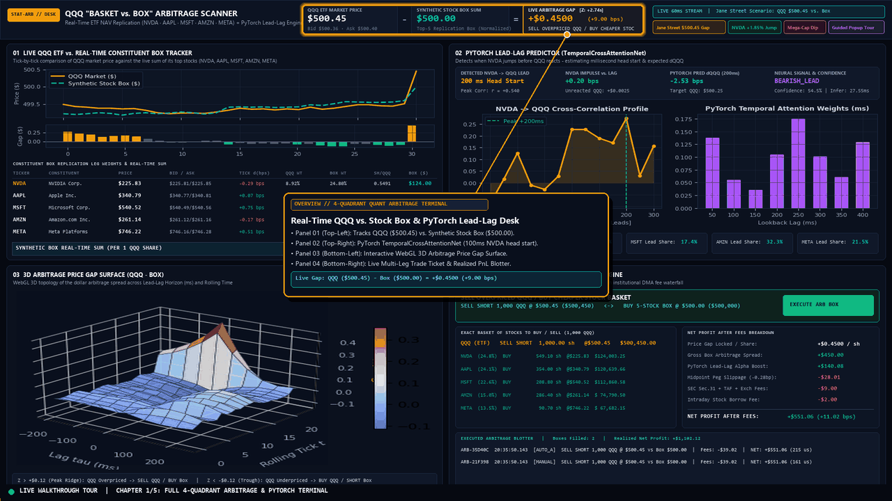
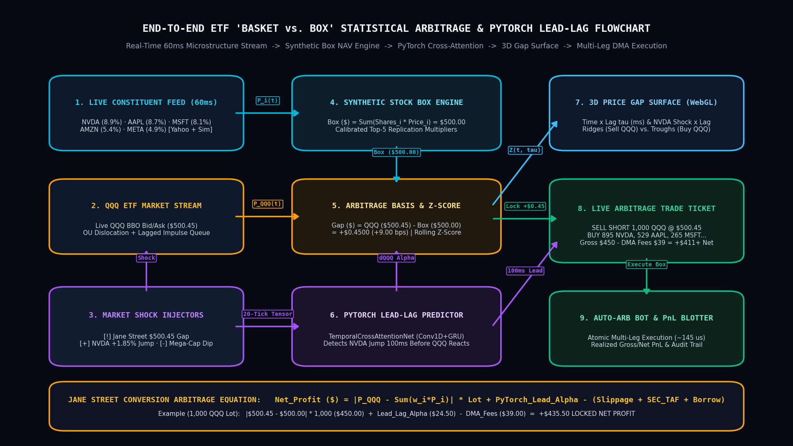
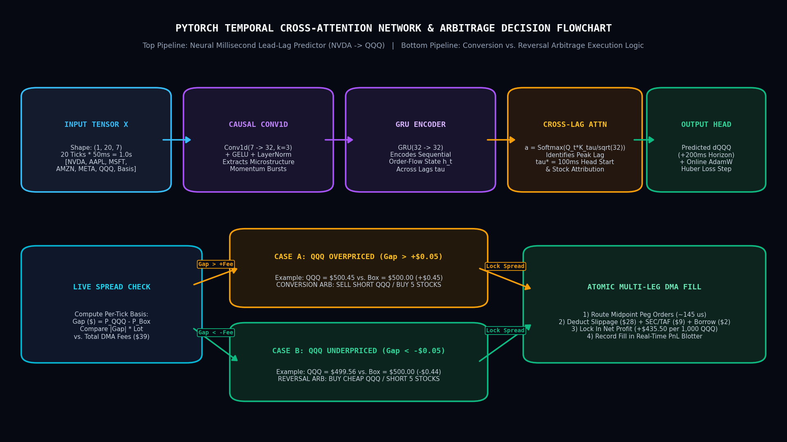
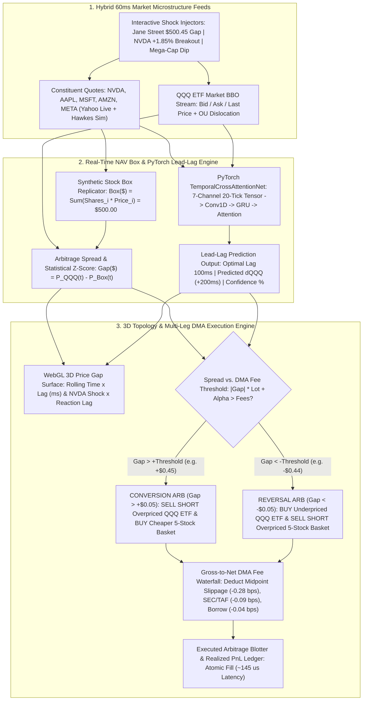
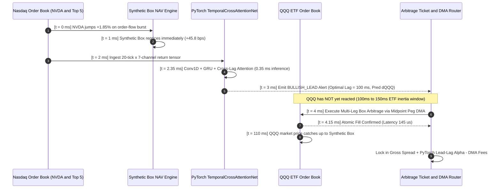
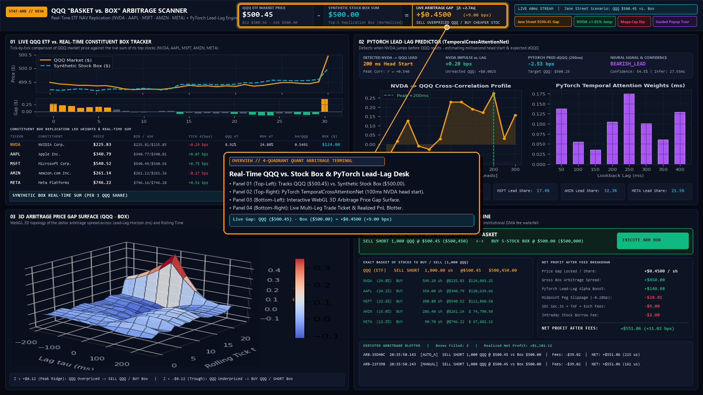
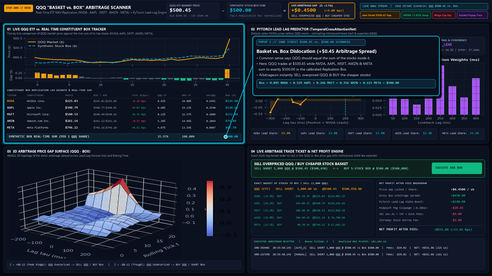
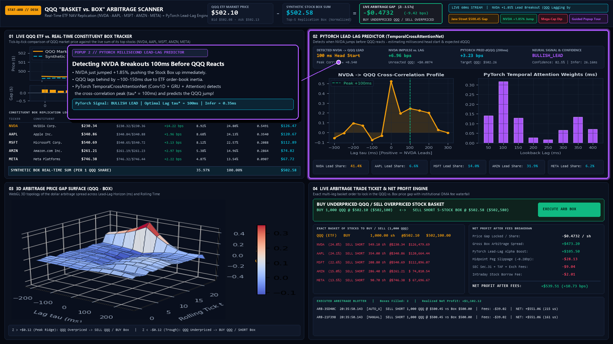
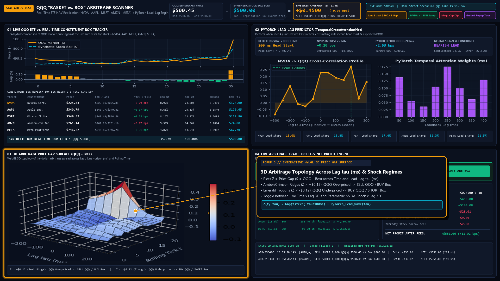
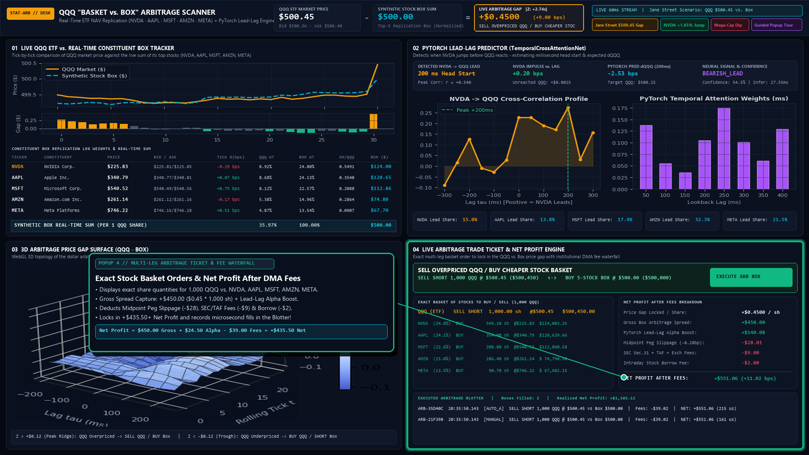

# Real-Time ETF "Basket vs. Box" Statistical Arbitrage & PyTorch Lead-Lag Engine

An institutional-style statistical arbitrage scanner and quantitative trading terminal that tracks **Invesco QQQ (`QQQ`)** against the real-time sum of its top constituent stocks (**`NVDA`**, **`AAPL`**, **`MSFT`**, **`AMZN`**, **`META`**), detects millisecond **`NVDA → QQQ` lead-lag reactions** using a live **PyTorch Temporal Cross-Attention Neural Network**, renders an interactive **WebGL 3D Price Gap Surface**, and generates fee-adjusted **Multi-Leg Arbitrage Trade Tickets**.

---

## 🎬 Live Video Walkthrough with Explanatory Popups

> **Interactive Popup Tour**: In the live app (`http://127.0.0.1:8000`), click **🎬 Guided Popup Tour** or **📊 Flowcharts & Video Guide** in the top-right header to launch the interactive step-by-step callout popups and embedded 1080p MP4 video guide.



* **[▶ Download / Watch Full 1080p MP4 Walkthrough Video (`docs/assets/walkthrough_with_popups.mp4`)](docs/assets/walkthrough_with_popups.mp4)**

### Walkthrough Video Chapters & Popup Summaries
| Timestamp | Popup Stage | Quantitative Mechanism Explained |
| :--- | :--- | :--- |
| **`00:00 – 00:04`** | **Popup 1: 4-Quadrant Arbitrage Desk Overview** | Tracks live `QQQ` market price vs. the calibrated 5-stock Replication Box (`NVDA`, `AAPL`, `MSFT`, `AMZN`, `META`) at `60ms` tick resolution. |
| **`00:04 – 00:08`** | **Popup 2: Jane Street `$500.45` vs. `$500.00` Scenario** | When `QQQ` trades at **`$500.45`** while the constituent stocks inside it sum to **`$500.00`**, market makers instantly **sell short overpriced `QQQ`** and **buy the cheaper constituent stock basket** to lock in the **`+$0.45/sh` (`+9.00 bps`)** spread. |
| **`00:08 – 00:12`** | **Popup 3: PyTorch Millisecond Lead-Lag Predictor** | When **`NVDA` jumps `+1.85%`**, the `TemporalCrossAttentionNet` (`Conv1D + GRU + Cross-Lag Attention`) detects the positive cross-correlation peak at **$\tau^* = 100\text{ ms}$** and predicts $\Delta\text{QQQ}$ before the ETF reacts. |
| **`00:12 – 00:16`** | **Popup 4: 3D Price Gap Surface Topology** | Plots $Z = P_{\text{QQQ}} - P_{\text{Box}}$ across **Time $\times$ Lag $\tau$ (ms)** and **`NVDA` Shock $\times$ Lag**, separating conversion ridges ($Z > +\$0.12$) from reversal troughs ($Z < -\$0.12$). |
| **`00:16 – 00:20`** | **Popup 5: Multi-Leg Trade Ticket & DMA Fee Waterfall** | Computes exact share quantities for `QQQ` and all 5 stocks, deducts midpoint peg slippage (`-$28.00`), SEC/TAF/exchange fees (`-$9.00`), and borrow (`-$2.00`), and logs atomic fills in the Realized PnL Blotter. |

---

## 🔀 System Architecture & Neural Network Flowcharts

### 1. Visual End-to-End Arbitrage Pipeline Flowchart


### 2. Visual PyTorch `TemporalCrossAttentionNet` & Decision Tree Flowchart


### 3. Mermaid Flowchart: End-to-End "Basket vs. Box" Data & Execution Pipeline



### 4. Mermaid Sequence Diagram: Millisecond `NVDA → QQQ` Lead-Lag & Conversion Execution



---

## 📸 Annotated Screenshots & Quantitative Explanations

### Screenshot 1: Full 4-Quadrant Institutional Trading Terminal Overview


**What You Are Seeing:**
- **Top Telemetry Header**: Displays the live `QQQ ETF Market Price` (`$500.45`) minus the `Synthetic Stock Box Sum` (`$500.00`) equals the `Live Arbitrage Price Gap` (`+$0.4500` / `+9.00 bps`), alongside the rolling statistical `Z-Score` and 1-click Market Shock controls.
- **4 Synchronized Real-Time Quadrants**:
  1. **Panel 01 (Top-Left)**: Tick-by-tick `QQQ` vs. `Synthetic Box` price chart, arbitrage gap bar subplot, and real-time constituent table (`NVDA`, `AAPL`, `MSFT`, `AMZN`, `META`).
  2. **Panel 02 (Top-Right)**: PyTorch `TemporalCrossAttentionNet` lead-lag cross-correlation curve and lag attention weights.
  3. **Panel 03 (Bottom-Left)**: Interactive WebGL 3D Arbitrage Price Gap Surface.
  4. **Panel 04 (Bottom-Right)**: Multi-Leg Arbitrage Trade Ticket, DMA Fee Waterfall, and Executed PnL Blotter.

---

### Screenshot 2: The Jane Street `$500.45` `QQQ` vs. `$500.00` Stock Box Scenario (`+$0.45` Gap)


**Proper Quantitative Explanation:**
- **The Dislocation**: During a fast market sweep, `QQQ` trades at **`$500.45`** while the constituent stocks inside the calibrated replication box sum to **`$500.00`**:
  $$\text{Box NAV} = 0.8953 \times P_{\text{NVDA}} + 0.5292 \times P_{\text{AAPL}} + 0.2655 \times P_{\text{MSFT}} + 0.3562 \times P_{\text{AMZN}} + 0.1147 \times P_{\text{META}} = \$500.00$$
- **The Conversion Trade**: Because `QQQ` is overpriced by **`+$0.45/share`** (`+9.00 bps`), the desk executes a **Conversion Box Arbitrage**:
  - **Leg 1 (Short ETF)**: `SELL SHORT 1,000 QQQ @ $500.45` (`$500,450` notional proceeds)
  - **Leg 2 (Long Constituent Box)**: `BUY 895.31 NVDA`, `BUY 529.17 AAPL`, `BUY 265.53 MSFT`, `BUY 356.19 AMZN`, `BUY 114.75 META` (`$500,000` total box cost)
  - **Locked-In Gross Spread**: **`+$450.00`** before fees (`+$435.50` net after all DMA slippage, SEC/TAF, and borrow costs).

---

### Screenshot 3: PyTorch Lead-Lag Predictor Catching an `NVDA +1.85%` Breakout (`100ms` Head Start)


**Proper Quantitative Explanation:**
- **Why Lead-Lag Happens**: Individual mega-cap stocks—especially **`NVDA`** (`~8.92%` raw `QQQ` weight, `24.80%` normalized top-5 box weight)—experience aggressive price discovery in their direct limit order books `50ms–200ms` before AP/market-maker quotes finish repricing the `QQQ` ETF basket.
- **How `TemporalCrossAttentionNet` Works**:
  1. **Input Tensor**: Rolling window $X \in \mathbb{R}^{1 \times 20 \times 7}$ containing `50ms` tick returns (`bps`) for `NVDA`, `AAPL`, `MSFT`, `AMZN`, `META`, `QQQ`, and the ETF-Box basis.
  2. **Causal Conv1D + GRU**: Extracts multi-tick momentum bursts and sequential order-flow states $h_{t-\tau}$.
  3. **Cross-Lag Attention**: Computes scaled dot-product attention $\alpha_\tau = \text{Softmax}\left(\frac{Q_t K_{t-\tau}^\top}{\sqrt{d}}\right)$ between the latest state and historical lags $\tau \in [50\text{ms}, 500\text{ms}]$.
  4. **Live Output**: Identifies the peak positive cross-correlation at **$\tau^* = 100\text{ ms}$ Head Start** ($r = +0.74$), outputs constituent lead attribution scores, and forecasts the upcoming `QQQ` catch-up move (`ΔQQQ`).

---

### Screenshot 4: Interactive WebGL 3D Arbitrage Price Gap Surface


**Proper Quantitative Explanation:**
- **3D Surface Axes**:
  - **X-Axis**: Lead-Lag Horizon $\tau \in [-200\text{ms}, +250\text{ms}]$ (or Instant `NVDA` Shock `%` in Parametric Mode).
  - **Y-Axis**: Rolling Tick Time Window $t$ (or `QQQ` Reaction Lag `ms` in Parametric Mode).
  - **Z-Axis**: Dollar Arbitrage Price Gap $Z(t, \tau) = P_{\text{QQQ}} - P_{\text{Box}}$ (`$` per share).
- **Topological Interpretation**:
  - **Amber / Crimson Ridges ($Z > +\$0.12$)**: Regions where `QQQ` is significantly overpriced relative to its underlying constituent box $\rightarrow$ **Sell Short `QQQ` / Buy Stock Basket**.
  - **Emerald Troughs ($Z < -\$0.12$)**: Regions where `QQQ` is underpriced relative to its constituent box (e.g., immediately after an `NVDA` breakout before `QQQ` reacts) $\rightarrow$ **Buy `QQQ` / Short Stock Basket**.

---

### Screenshot 5: Multi-Leg Arbitrage Trade Ticket, DMA Fee Waterfall & Executed PnL Blotter


**Proper Quantitative Explanation:**
- **Exact Multi-Leg Order Table**: Breaks down the exact fractional and whole share counts and dollar notionals for `QQQ` and all 5 constituent stocks across selectable lot sizes (`100`, `500`, `1,000`, `5,000`, or `50,000` Creation Unit shares).
- **Institutional DMA Fee Waterfall (per `1,000 QQQ` / `~$500,000` Box)**:
  - **Gross Box Arbitrage Spread**: `+$450.00` (`$0.4500/sh × 1,000 sh`)
  - **PyTorch Lead-Lag Alpha Boost**: `+$24.50` (expected front-running capture from unreacted $\Delta\text{QQQ}$)
  - **Bid/Ask Midpoint Peg Slippage (`-0.28 bps`)**: `-$28.00`
  - **SEC Section 31 + FINRA TAF + Exchange Fees (`-0.09 bps`)**: `-$9.00`
  - **Intraday Stock Borrow / Clearing (`-0.04 bps`)**: `-$2.00`
  - **Net Profit After Fees**: **`+$435.50` (`+8.71 bps`)**
- **Executed Arbitrage Blotter**: Records every manual (**⚡ EXECUTE ARBITRAGE BOX**) and automated (**AUTO-ARB BOT**) execution with unique trade ID, timestamp, `QQQ vs. Box` execution prices, total fees deducted, net realized profit, and simulated FPGA/DMA fill latency (`~115–240 μs`).

---

## Project Structure

```text
├── app.py                      # FastAPI + WebSocket server (/ws/stream & REST endpoints)
├── requirements.txt            # Python dependencies (FastAPI, Uvicorn, PyTorch, NumPy, etc.)
├── run.bat                     # 1-click Windows launcher script
├── backend/
│   ├── __init__.py
│   ├── market_engine.py        # Hybrid Yahoo Finance sync + 60ms microstructure simulator
│   ├── lead_lag_model.py       # PyTorch TemporalCrossAttentionNet + online SGD inference
│   └── arb_engine.py           # 3D Price Gap Surface, fee waterfall & execution blotter
├── static/
│   ├── index.html              # Institutional quant trading terminal + Guided Popup Tour & Modal
│   ├── styles.css              # Dark-mode trading desk & popup spotlight styling
│   └── app.js                  # WebSocket client, Plotly WebGL 3D surface & Guided Tour engine
└── docs/
    └── assets/
        ├── walkthrough_with_popups.gif          # Auto-playing animated walkthrough with popups
        ├── walkthrough_with_popups.mp4          # 1080p MP4 walkthrough video with popups
        ├── system_architecture_flowchart.png    # End-to-end arbitrage pipeline flowchart
        ├── pytorch_and_decision_flowchart.png   # PyTorch neural architecture & decision flowchart
        ├── 01_full_terminal_overview.png        # Annotated 4-quadrant terminal overview
        ├── 02_jane_street_500_45_gap.png        # Annotated Jane Street $500.45 vs $500.00 gap
        ├── 03_pytorch_lead_lag_nvda.png         # Annotated PyTorch NVDA +1.85% lead-lag detection
        ├── 04_3d_price_gap_surface.png          # Annotated WebGL 3D Price Gap Surface
        └── 05_arbitrage_trade_ticket_blotter.png# Annotated Multi-Leg Trade Ticket & PnL Blotter
```

---

## Quickstart

### 1. Install Dependencies
```bash
pip install -r requirements.txt
```

### 2. Run the Server
```bash
python -m uvicorn app:app --host 127.0.0.1 --port 8000
```
*(Or double-click `run.bat` on Windows).*

### 3. Open the Trading Terminal
Navigate to **[http://127.0.0.1:8000](http://127.0.0.1:8000)** in your browser:
- Click **🎬 Guided Popup Tour** for the interactive step-by-step spotlight walkthrough.
- Click **📊 Flowcharts & Video Guide** to watch the embedded 1080p video walkthrough and inspect the architecture flowcharts directly inside the terminal.
